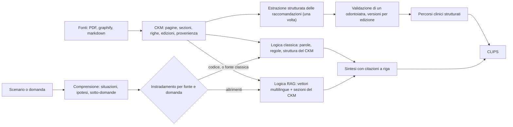

# DentalCare Clinical Knowledge — lezioni apprese, ricerca ibrida e percorsi clinici strutturati

**Versione:** 1.0 · **Data:** 23 novembre 2026  
**Proposta:** #136 del registro delle proposte  
**Progetto:** [CLIPS — AnalysisFunctionLLM, il componente Clinical Knowledge](CLIPS-AnalysisFunctionLLM.md)  
**Stato:** logica RAG ✅ realizzata e pubblicata il 24/11/2026 · percorsi clinici strutturati 📋 proposta · decisioni del 23/11 in §8 · misura in §3

> **Nome.** «DentalCare Clinical Knowledge» (DCK) è il nome deciso il 21/11/2026 per AnalysisFunctionLLM. Dal rilascio del 24/11/2026 (PR #35) lo usa anche l'interfaccia; prima era «DentalCare Support».

## 1. In breve

DCK deve diventare la base di conoscenza da cui CLIPS ricava i percorsi clinici odontoiatrici. A oggi:

- **costruito bene:** le fonti strutturate con la provenienza (CKM) e il banco di prova con le frasi chiave;
- **costruito male:** al centro c'è una ricerca per parole, e un ciclo di apprendimento in cui il modello le insegna equivalenze italiano↔inglese e ordinamento, una regola alla volta. Il ciclo è costoso e ogni regola rende meno della precedente.

**Proposta:**
- una **logica RAG** accanto alla **logica classica**: per ogni domanda risponde una sola delle due, scelta per fonte e per domanda;
- taratura della ricerca senza modello;
- modello solo dove serve;
- percorsi clinici estratti in forma strutturata e validati da un odontoiatra.

## 2. Cosa abbiamo costruito

| Componente | Cosa fa | Giudizio |
|---|---|---|
| CKM (Canonical Knowledge Model) | Trasforma le fonti (PDF, graphify, markdown) in pagine, sezioni, righe ed edizioni, con la provenienza di ogni brano | Da tenere |
| Qualità delle fonti | Conversione dei PDF, testatine e piè di pagina, codifica, edizioni della stessa opera | Da tenere |
| Banco di prova | Domande generate dalle fonti, con frasi chiave e file attesi. Controllo deterministico: le frasi sono nel contesto e il file atteso è citato | Da tenere: diventa il banco di prova del RAG |
| Ricerca | Per parole, con radici italiane semplificate, più profili di concetti pesati (equivalenze apprese) e una quarantina di regole di ordinamento (R1–R46) | Punto debole |
| Ciclo di apprendimento e pilota automatico | Il modello risponde, giudica, diagnostica e propone concetti. Seguono candidati, controllo delle regressioni e promozione | Costoso per quello che ottiene |

## 3. Cosa abbiamo misurato

- **Pilota del 22/11 (giro 2):** 77 chiamate al modello, 6 correzioni accettate, nessuna promossa. Un'equivalenza superflua («parodontite = periodontitis», presente in 267 pagine su 2021) rompeva un caso già risolto.
- **Pilota del 23/11:** 49 chiamate e 3 casi risolti e promossi (heldout-5, training-12, resume-heldout-1). Per arrivarci è servito prima compattare il profilo, che era al massimo di 96 concetti (96 → 66).
- **Casi fermi per l'ordinamento (training-5, training-11):** la pagina che risponde è nel grafo ma resta fuori dal contesto. Esempio training-11 (SDCEP 2022, paziente con DOAC e rischio emorragico più alto), misurato senza modello:

  | Brano | Parole della domanda | Regole | Punteggio |
  |---|---|---|---|
  | p.11, introduzione generale | 2 | 20 | 22 (primo) |
  | p.16, tabella delle procedure | 0 | 20 | 20 |
  | p.29, la risposta | 1 | 14 | 14 (undicesimo) |

  Il punteggio somma i concetti trovati, così un'introduzione che nomina tutti gli argomenti batte la pagina specifica. Le pagine 28 («low risk») e 29 («higher risk») si distinguono per una sola parola.
- **Casi clinici complessi (22/11):** con la domanda intera le frasi chiave entrano nel contesto in 0 casi su 16. Con un passo di comprensione e una ricerca per ogni ipotesi diagnostica, in 12 su 16.
- **Banco di prova:** 163 casi su 5 fonti; con la logica classica, dopo il pilota del 23/11, le frasi chiave entrano nel contesto in 153.

**Misura della logica RAG (23/11, senza chiamate al modello delle risposte).** Embedding Cohere `embed-v4.0`, stesso banco di prova e stesso budget di contesto della classica:

| Fonte (casi) | Classica | RAG semplice | RAG + sezioni del CKM (3200) | RAG + sezioni (6000) |
|---|---|---|---|---|
| Fonti_Cliniche (62) | 52 | **62** | 61 | 58 |
| Guida_DentalCare_Pro (54) | **54** | **54** | 53 | 53 |
| Guida_ESE (38) | **38** | 30 | 34 | 36 |
| Guida_EFP (6) | 6 | 6 | 6 | 6 |
| Guida_01 (3) | 3 | 3 | 3 | 3 |
| **Totale (163)** | 153 | 155 | 157 | 156 |

- **La RAG vince dove la classica è debole.** Risolve tutti i 10 casi aperti di Fonti_Cliniche (lingua diversa, pagine quasi uguali), compresi quelli su cui il pilota aveva speso decine di chiamate.
- **La classica vince dove conta la struttura.** Sono le raccomandazioni con codice la cui spiegazione continua oltre il salto pagina (ESE). Comporre il contesto con le sezioni del CKM recupera gran parte del divario.
- **Scegliendo la logica per fonte e per domanda** (domanda con codice → classica, altrimenti la logica principale della fonte) si arriva a 162–163 casi su 163.
- **Una «cascata» sui punteggi non funziona.** I casi falliti hanno punteggi di ricerca uguali o più alti dei riusciti, in entrambe le logiche.
- **Tempi e costi:**
  - con Cohere il vettore di una domanda richiede meno di un secondo e reindicizzare tutte le fonti costa centesimi;
  - in locale, su un portatile senza GPU, indicizzare Fonti_Cliniche richiede 2 ore e il riordino 31 secondi per domanda;
  - il riordino, con Cohere, non migliora i risultati.
- **Avvertenza:** la classica è stata addestrata su questi stessi casi. Prima di adottare la scelta automatica serve una verifica su domande nuove.

## 4. Cosa avremmo potuto fare meglio

1. **Banco di prova su scenari clinici.** Le domande generate iniziano quasi tutte con «Secondo la guida X…». Quel formato ha richiesto regole per riconoscere il documento nominato (R11, R30, R44), che un medico davanti a un paziente non userà. L'uso reale è uno scenario: il paziente, le sue condizioni, le raccomandazioni di più guide.
2. **Ricerca ibrida dall'inizio.** Ricerca per parole più ricerca multilingue per significato, più un modello di riordino. Domanda in italiano su fonte inglese, parafrasi e pagine quasi uguali sono i casi tipici che una ricerca per parole non distingue. Le equivalenze apprese ne sono un'approssimazione costruita a mano, con chiamate a pagamento.
3. **Taratura senza modello.** La ricerca si misura con il controllo deterministico, cioè se le frasi chiave sono fra i primi brani, senza alcuna chiamata. Il modello che giudica le risposte serve solo a campione.
4. **Un confronto all'inizio.** Uno o due giorni per mettere a confronto ricerca per parole e ricerca ibrida sullo stesso banco di prova avrebbero orientato il lavoro successivo.
5. **Il modello dove serve davvero:**
   - comprendere e scomporre il caso clinico;
   - scrivere il percorso con le citazioni;
   - estrarre le raccomandazioni, una volta sola.

## 5. Architettura proposta

**Due logiche, una per domanda.** La logica classica (parole, regole apprese, struttura del CKM) resta com'è. La logica RAG trova i brani per significato e compone il contesto con le sezioni del CKM. Le due logiche non si mescolano mai: per ogni domanda e ogni fonte risponde una sola, e la risposta dice quale e perché. Per ogni fonte l'amministratore sceglie:

~~~
Scheda della fonte → Logica di ricerca
  (•) Classica    — parole + apprendimento (predefinita)
  ( ) RAG         — significato + sezioni del CKM
  ( ) Automatica  — logica principale della fonte; domande con codice → classica
~~~

La logica principale e il tetto di sezione si scelgono con una **taratura senza modello** sul banco di prova. A parità di risultato resta principale la classica, che è locale, gratuita, più veloce e non dipende da un servizio esterno. Il progetto di dettaglio è nel repo di DCK (`docs/plans/2026-11-23-logica-rag-design.md`).

Il piano di CLIPS prevede già un livello vettoriale e il Clinical RAG Service dietro un'interfaccia astratta ([lavoro previsto](CLIPS-AnalysisFunctionLLM.md#lavoro-previsto)). La logica RAG è quel livello, costruito dentro DCK dietro la stessa interfaccia.

| Livello | Scelta proposta | Cosa risolve |
|---|---|---|
| Livello | Scelta | Cosa risolve |
|---|---|---|
| Ricerca per parole | La logica classica, usata per le domande con codice e per le fonti dove vince | Codici, sigle, percentuali, termini esatti, struttura |
| Ricerca per significato | Embedding di un fornitore esterno con accesso diretto, uno alla volta: Cohere `embed-v4.0` (misurato) o Voyage AI `voyage-4-large` (da misurare). In futuro pgvector dietro la stessa interfaccia (ADR-04-02 di CLIPS) | Italiano↔inglese e parafrasi, senza equivalenze scritte a mano |
| Composizione del contesto | Sezioni del CKM seguite oltre il salto pagina, con un tetto per fonte | Raccomandazioni la cui spiegazione continua nella pagina dopo |
| Riordino | Non necessario: con Cohere non ha migliorato i risultati (misurato) | — |
| Modello | Comprensione del caso, sintesi, estrazione | Casi complessi in tre passi: comprensione, ricerca per sotto-domanda, percorso |

**Servizio esterno.** In locale, su un portatile senza GPU, la logica RAG è impraticabile: 2 ore per indicizzare, 31 secondi di riordino per domanda. Il servizio misurato è Cohere, con accesso diretto. In alternativa c'è Voyage AI (MongoDB), da misurare prima di sceglierlo: i primi 200 milioni di token sono gratuiti e c'è un endpoint con geografia Europa. Ne è attivo uno alla volta. Un workflow n8n è servito solo alla prova e aggiunge circa 0,5 s a chiamata. Serve una chiave Cohere a pagamento, oppure un metodo di pagamento registrato su Voyage AI. Privacy: voci D-113…D-115 del registro DPIA.

### 5.1 Guida DentalCare Pro e le altre guide dell'applicazione

La Guida DentalCare Pro alimenta la chat «Chiedi all'Academy»: domande in italiano su documentazione in italiano. Con la logica classica le frasi chiave entrano nel contesto in tutti i 54 casi. Con la logica RAG:

- **misurato: anche con la logica RAG 54 su 54.** A parità resta principale la classica, che è locale, gratuita, più veloce e non dipende da un servizio esterno;
- **la RAG resta disponibile** se in futuro le parafrasi degli utenti («spostare un appuntamento» contro «riprogrammare la visita») mettessero in difficoltà la classica;
- **restano le funzioni di struttura costruite per la guida:** passi numerati delle procedure, sezioni intere, domande negative («cosa non fa…»), tabelle con il testo che le introduce;
- **i percorsi clinici strutturati (§6) non la riguardano:** valgono solo per le fonti cliniche.

Il contratto delle risposte verso DentalCare (testo e citazioni) non cambia.

## 6. Percorsi clinici strutturati

La chat risponde dal testo a ogni domanda. Un percorso clinico per CLIPS ha invece bisogno di **raccomandazioni strutturate, validate e versionate**.

1. **Estrazione, una volta per edizione.** Il modello estrae le raccomandazioni di una guida in una forma fissa:
   - popolazione e condizione;
   - azione e tempi;
   - controindicazioni;
   - forza della raccomandazione e livello dell'evidenza;
   - documento, edizione, pagina e righe della fonte.
2. **Validazione.** Un odontoiatra conferma, corregge o scarta ogni raccomandazione. Una nuova edizione della guida produce una nuova versione, senza cancellare la precedente.
3. **Percorso.** Le raccomandazioni validate si compongono in percorsi (diagnosi, stratificazione del rischio, fasi, precauzioni). Con FHIR già previsto per CLIPS ([specifica tecnica](../../04-Architecture-Handbook/17-Clinical-Event-Model-and-Predictive-AI.md)), lo standard di riferimento è [HL7 CPG-on-FHIR](https://hl7.org/fhir/uv/cpg/) (PlanDefinition, ActivityDefinition).
4. **Ruolo del RAG.** Spiega e cita: perché il percorso propone un passo, con il brano della fonte. Copre anche le domande fuori dai percorsi.

**I vincoli di CLIPS restano** ([vincoli](CLIPS-AnalysisFunctionLLM.md#5-vincoli)):
- il servizio restituisce evidenze citate e non decide;
- il percorso validato è conoscenza, e ogni proposta la conferma il medico;
- fino ai gate di CLIPS nessun dato di pazienti arriva al servizio, e gli scenari del banco di prova sono sintetici;
- una guida non validata clinicamente non è evidenza clinica.

**Perché conviene anche per la conformità.** Le informazioni cliniche individualizzate possono dare a CLIPS una destinazione medica secondo il MDR (regola 11). Una base di raccomandazioni validate e versionate, ognuna con la sua fonte, è più facile da documentare e verificare di un ciclo che ritara da solo la ricerca.

## 7. Cosa hanno in comune le due logiche

**In comune:**
- il CKM, con la provenienza e le citazioni a riga: alimenta la suddivisione in brani e le citazioni del RAG;
- la qualità delle fonti: conversione dei PDF, testatine, codifica, edizioni;
- il banco di prova con le frasi chiave e il controllo deterministico;
- gli strumenti di misura senza modello e la regola «nessun caso peggiore».

**Solo della logica classica:**
- le equivalenze italiano↔inglese apprese;
- le regole di ordinamento;
- compattazione e potatura dei profili;
- il pilota automatico che le corregge.

**Solo della logica RAG:** l'indice dei vettori, il modello di embedding e quello di riordino.

**Non si smonta nulla.** La logica classica resta disponibile finché il committente non sceglie. Dopo la scelta si toglie solo ciò che nessuna logica attiva usa più. Il pilota resta utile come prova di regressione completa (risposta e giudizio) a ogni rilascio.

## 8. Prossimi passi proposti

| # | Passo | Costo | Criterio di successo |
|---|---|---|---|
| 1 | ✅ Pilota fermato il 23/11, dopo la promozione di 3 casi (49 chiamate) | — | — |
| 2 | ✅ Misura usa e getta della logica RAG sugli stessi casi della classica (§3): con instradamento per fonte e domanda, 162–163 casi su 163 contro 153 | Centesimi (Cohere) | Recuperati i casi fermi per l'ordinamento; la classica resta migliore sulle raccomandazioni con codice |
| 3 | Prototipo di estrazione strutturata su una guida (SDCEP 2022, anticoagulanti), con revisione clinica | Poche chiamate più il tempo di un odontoiatra | Misura del lavoro umano per un percorso validato |
| 4 | ✅ Logica RAG implementata il 23/11: modulo suo, tre modi per fonte (Classica, RAG, Automatica), fornitore Cohere o Voyage AI, taratura senza modello, verifica su domande nuove. Misura senza costi sui 169 casi: Automatica 167, classica 156. Prova dal vivo con Cohere su Fonti_Cliniche: la taratura propone «automatica-0», 68 casi su 68 contro 55 della classica. Revisione finale approvata; i difetti segnalati sono corretti. Pubblicata il 24/11/2026 dopo la conferma del committente (PR #35 del repo DCK). Documenti nel repo DCK: `docs/plans/2026-11-23-logica-rag-design.md` e `-piano.md` | Chiave Cohere a pagamento o Voyage AI con metodo di pagamento; pochi euro al mese. Indice di Fonti_Cliniche: circa 60 chiamate | Nessun caso peggiore: la taratura non propone mai una variante che ne ha. Guida DentalCare Pro resta in Classica (54 su 54) |

**Decisioni del committente (23/11):**
- due logiche affiancate e mai mescolate, con un interruttore nel codice. Scartati il branch separato (due server, correzioni da fare due volte, fusione finale) e il servizio separato (progetto molto più grande);
- per ogni fonte tre modi: Classica (predefinita), RAG, Automatica. In Automatica, domanda con codice → classica, altrimenti la logica principale della fonte;
- accesso diretto a Cohere; n8n solo per la prova;
- secondo fornitore Voyage AI, uno attivo alla volta per tutte le fonti;
- documento di progetto approvato; sviluppo e rilascio affidati a un team di agenti;
- pilota fermato;
- misura del passo 2 fatta.

**Da decidere:** la guida e l'odontoiatra per il prototipo del passo 3.

## 9. Riferimenti

- [CLIPS — AnalysisFunctionLLM, il componente Clinical Knowledge](CLIPS-AnalysisFunctionLLM.md)
- [Progetto CLIPS](2026-11-12-fase-4-clinical-intelligence.md)
- [Clinical Event Model, FHIR e Predictive AI](../../04-Architecture-Handbook/17-Clinical-Event-Model-and-Predictive-AI.md)
- [HL7 FHIR Clinical Practice Guidelines (CPG-on-FHIR)](https://hl7.org/fhir/uv/cpg/)
