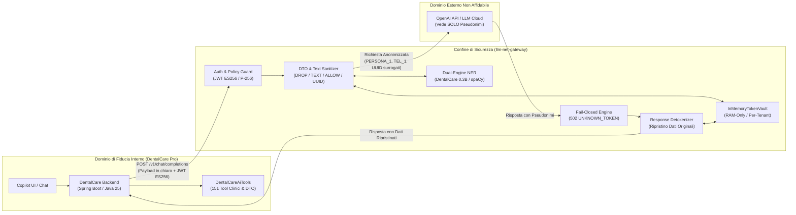
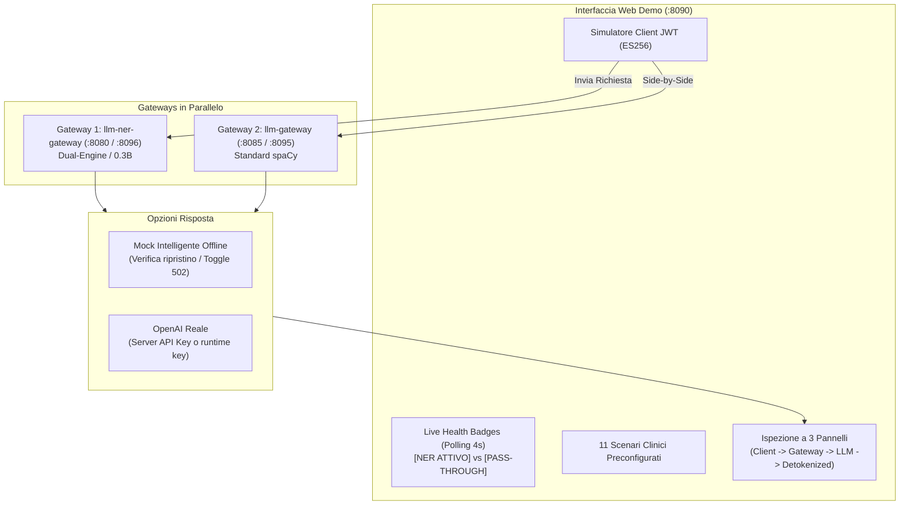

# 14 — LLM NER Gateway & Demo Simulator

Documentazione architetturale e operativa dei componenti di sicurezza e anonimizzazione privacy-preserving per le chiamate verso modelli linguistici (LLM):
- **`llm-ner-gateway`** (Repository: [`fpapale/llm-ner-gateway`](https://github.com/fpapale/llm-ner-gateway)): Reverse proxy enterprise Java Spring Boot 3.5 / Java 25 con motore Dual-Engine NER in Python.
- **`llm-gateway-demo`** (Repository: [`fpapale/llm-gateway-demo`](https://github.com/fpapale/llm-gateway-demo)): Suite web di collaudo, simulatore client e ispettore Side-by-Side a 3 pannelli.

> [!IMPORTANT]
> **AUTONOMIA TOTALE E ARCHITETTURA CONTAINER DOCKER**
> Il sistema è completamente autonomo e opera nativamente tramite **container Docker** sulla rete `dentalcarepro_dentalcarepro`:
> - Il repository **`llm-ner-gateway`** incapsula ed espone **entrambi i motori NER**: il modello fine-tuned `llm-ner-dentalcare-0.3B` e il modello standard `spaCy` (`it_core_news_lg`).
> - Il deployment Docker Compose avvia sia l'istanza primaria (:8080 su 0.3B) sia l'istanza di confronto (:8085 con `NER_MODEL=spacy`), generate dalla **medesima immagine** di `llm-ner-gateway`.
> - Non esiste alcuna dipendenza verso cartelle o repository legacy per l'esecuzione di spaCy.
> - L'installazione e la manutenzione sul server (`192.168.0.72`) avvengono esclusivamente tramite gli script bash idempotenti `scripts/install-llm_gateway.sh` e `scripts/update-llm-gateway.sh`.

---

## 1. Visione Architetturale e Ruolo nel Sistema

Nelle applicazioni sanitarie multi-tenant come **DentalCare Pro**, l'interazione con modelli di fondazione esterni (es. OpenAI GPT-4.1) introduce un severo rischio regolatorio: l'esportazione non controllata di **dati personali (Art. 4 GDPR)** e **dati particolari sulla salute (Art. 9 GDPR)** verso server di terze parti.

`llm-ner-gateway` costituisce il **confine di fiducia invalicabile (Trust Boundary)** tra l'ecosistema applicativo (backend Spring Boot, tool del Copilot, gestione errori) e i provider LLM pubblici:



### Principi di Progetto Chiave

1. **Nessun Dato Sensibile all'LLM**: Nomi di pazienti e medici, numeri di telefono, indirizzi, codici fiscali, IBAN e numeri di documenti non lasciano mai l'infrastruttura in chiaro.
2. **Zero-Knowledge sul Provider**: Il fornitore LLM riceve token pseudonimi (`PERSONA_1`, `TEL_1`), segnaposto irreversibili (`[CATASTO]`, `[TARGA]`) e UUID surrogati effimeri.
3. **Nessuna API Key nel Core**: La chiave API di OpenAI risiede unicamente nel gateway. Il backend applicativo possiede solo la propria chiave privata crittografica EC per firmare i token di sessione.
4. **Isolamento Totale in RAM**: Il vault delle corrispondenze (`InMemoryTokenVault`) è memorizzato unicamente nella memoria volatile del gateway, indicizzato per `tenantRef` e `conversationRef`. Nessun dato pseudonimizzato viene persistito su database o disco.
5. **Fail-Closed su Allucinazioni**: Se l'LLM allucina un token non registrato nel vault della conversazione, la richiesta viene abortita all'istante con codice `502 UNKNOWN_TOKEN`, impedendo l'iniezione o il leak di dati cross-tenant.

---

## 2. Modello di Sicurezza e Controllo Accessi

### 2.1 Autenticazione Client tramite JWT `ES256` (Curva Ellittica P-256)

L'accesso a `llm-ner-gateway` è rigidamente controllato da crittografia asimmetrica a curva ellittica:
- **Algoritmo**: `ES256` (ECDSA con curva NIST P-256 e SHA-256).
- **Chiavi**: Il client possiede la chiave privata (`keys/client-private.pem`), mentre il gateway possiede unicamente la chiave pubblica (`config/client-public.pem`).
- **Claim Obbligatori**:
  - `iss` / `sub`: Identificativo dell'applicazione chiamante (es. `dentalcare`).
  - `application`: Dominio applicativo autorizzato (es. `dentalcare`, `legal`).
  - `purpose`: Finalità specifica del trattamento (es. `copilot-admin`, `clinical-copilot`, `smart-error`, `case-analysis`).
  - `tenantRef`: Identificativo univoco del tenant (es. `tenant-studio-rossi`).
  - `actorRef`: Identificativo dell'utente operatore.
  - `conversationRef`: Identificativo univoco della sessione di chat per il partitioning della memoria del vault.

### 2.2 Policy di Sanitizzazione per Finalità (`ApplicationPolicy`)

Il gateway applica policy differenziate in base alla tupla `(application, purpose)`:

| Policy | Finalità Applicativa | Campi Clinici | Note / Anamnesi | Campi Fiscali & Finanziari | Dati Identificativi PII |
| :--- | :--- | :---: | :---: | :---: | :---: |
| **`dentalcare / copilot-admin`** | Gestione operativa studio, agenda e richiami | `DROP` | `DROP` | `DROP` | Pseudonimizzati (`PERSONA_n`) |
| **`dentalcare / clinical-copilot`** | Cartella clinica e piano di cura per medici | `ALLOW` (denti, allergie, terapie) | `TEXT` (bonifica PII) | `DROP` (IBAN, CF) | Pseudonimizzati (`PERSONA_n`) |
| **`dentalcare / smart-error`** | Umanizzazione errori applicativi (#54) | `DROP` | Redazione irreversibile | `DROP` | Redazione irreversibile (`[NOME]`, `[ID]`) |
| **`legal / case-analysis`** | Consulenza legale e perizie odontoiatriche | `ALLOW` | `TEXT` | `ALLOW` | Pseudonimizzati + Checksum P.IVA |

---

## 3. Motore Dual-Engine NER e Modello Odontoiatrico `0.3B`

### 3.1 Architettura Dual-Engine (`config/config.yaml`)

Il sottosistema di Named Entity Recognition (`ner/app.py`) è un microservizio FastAPI parametrizzato che supporta la selezione dinamica del motore:

```yaml
ner:
  model: "auto"              # Opzioni: "auto" | "transformers" | "spacy"
  variant_max_length: 2000
  extra_app_words: []
```

```mermaid
flowchart TD
    Req["Richiesta NER da Gateway"] --> CheckConf{"Configurazione ner.model"}
    CheckConf -->|"model: transformers"| LoadTrans["Carica Modello Fine-Tuned<br/>config/llm-ner-dentalcare-0.3B"]
    CheckConf -->|"model: spacy"| LoadSpacy["Carica spaCy<br/>it_core_news_lg"]
    CheckConf -->|"model: auto"| CheckDir{"Esiste cartella<br/>llm-ner-dentalcare-0.3B?"}
    CheckDir -->|Sì| LoadTrans
    CheckDir -->|No (Fallback automatico)| LoadSpacy
    LoadTrans --> Infer["Inferenza Estrazione Entità (CPU)"]
    LoadSpacy --> Infer
    Infer --> Resp["Entità Rilevate (JSON)"]
```

### 3.2 Modello Fine-Tuned Specializzato: `llm-ner-dentalcare-0.3B`

Derivato dall'architettura **ModernBERT / mmBERT** a 22 categorie PII italiane e specializzato tramite fine-tuning supervisionato:
- **Dataset di Training**: 3.000 frasi sintetiche ad alta densità clinica e amministrativa odontoiatrica (cartelle cliniche, diari, note anamnestiche, fatture, comunicazioni ai pazienti).
- **Metriche di Prestazione**:
  - **Precision**: 99.1%
  - **Recall**: 97.9%
  - **F1-Score**: 0.985
- **Immunità ai Falsi Positivi sui Menu UI**: I motori generici come `spaCy` tendono a classificare erroneamente termini dell'interfaccia utente (es. *Agenda*, *Fatturazione*, *Magazzino*, *Dashboard*) come nomi di persona (`PER`). Il modello 0.3B garantisce **zero falsi positivi** sul dizionario applicativo DentalCare.
- **Risoluzione Nomi Omografi e Verbi di Contatto**: Isola correttamente il nome proprio da verbi imperativi di contatto (*"Chiama Mario Rossi"* $\rightarrow$ estrae solo *"Mario Rossi"*, preservando *"Chiama"* per il function calling).

### 3.3 Checksum Algoritmici ed Entità PII Estese

Oltre all'elaborazione neurale, il gateway integra validatori deterministici ad alta affidabilità:
- **Partita IVA Italiana**: Validazione con algoritmo checksum **Luhn 11 cifre**, con verifica del codice ufficio provinciale (cifre 8-10). Evita falsi positivi su sequenze numeriche o codici articolo.
- **Codice Fiscale**: Validazione algoritmica dei 16 caratteri alfanumerici con carattere di controllo pari/dispari.
- **IBAN**: Validazione ISO 7064 MOD 97-10.
- **Nuove Categorie Estese (Redazione Irreversibile)**:
  - `ADDRESS`: Indirizzi di residenza e vie (sempre cancellati, mai ripristinabili verso l'esterno).
  - `CATASTO`: Riferimenti catastali (foglio, particella, subalterno).
  - `DOCID`: Carte d'identità, patenti, passaporti.
  - `TARGA`: Targhe automobilistiche italiane.

---

## 4. Modalità Pass-Through (`pass-through.mode`)

Per esigenze di benchmarking prestazionale, comparazione qualitativa delle risposte LLM o ambienti di test interni, `llm-ner-gateway` include una modalità **Pass-Through trasparente**:

### 4.1 Funzionamento e Comportamento

- **Configurazione**: Parametro `pass-through.mode=true` in `config/application.properties` (o variabile d'ambiente `PASS_THROUGH_MODE=true`). Default: `false`.
- **Esecuzione Bypass**:
  1. La validazione del token JWT client e la verifica della policy restano **pienamente attive** a salvaguardia dell'accesso.
  2. Il microservizio NER viene **disattivato a caldo**: `NerDetector.detect()` ritorna immediatamente una lista vuota senza effettuare chiamate di rete.
  3. La pseudonimizzazione privacy viene completamente **saltata**: il payload originario viene inoltrato tale e quale a OpenAI.
  4. La risposta del fornitore viene restituita direttamente al client senza tentativi di detokenizzazione.

### 4.2 Telemetria ed Esposizione dello Stato

La modalità attiva è ispezionabile in tempo reale tramite tre canali distinti:

1. **Endpoint REST Dedicato**:
   `GET /v1/status` (endpoint pubblico non autenticato per sonde di bilanciamento e UI demo):
   ```json
   {
     "status": "UP",
     "passThroughMode": true,
     "nerEnabled": false
   }
   ```
2. **Spring Boot Actuator Health**:
   L'indicatore dedicato `GatewayHealthIndicator` contribuisce a `/actuator/health`:
   ```json
   {
     "status": "UP",
     "components": {
       "gateway": {
         "status": "UP",
         "details": {
           "passThroughMode": false,
           "nerEnabled": true
         }
       }
     }
   }
   ```
3. **Header HTTP di Risposta**:
   Tutte le chiamate a `POST /v1/chat/completions` restituiscono gli header:
   ```http
   X-Gateway-Pass-Through: true
   X-Gateway-Ner-Enabled: false
   ```

---

## 5. `llm-gateway-demo`: Suite di Collaudo e Simulatore Side-by-Side

Applicazione web standalone basata su **FastAPI** e interfaccia interattiva moderna **HTML5/CSS3** (porta **`8090`**).



### 5.1 Funzionalità Principali

1. **Generazione Automatica Chiavi Crittografiche**: Genera e persiste la coppia EC P-256 (`keys/client-private.pem` e `keys/client-public.pem`) firmando al volo ogni richiesta con JWT conformi.
2. **Health Check Dinamico con Polling a 4s**:
   - Pallino verde + badge verde **`[NER ATTIVO]`**
   - Pallino verde + badge arancione **`[PASS-THROUGH]`**
   - Pallino rosso per gateway o microservizi NER offline
   - Aggiornamento automatico dei label nei dropdown di selezione.
3. **Confronto Side-by-Side**: Permette di inviare lo stesso payload contemporaneamente a Gateway 1 (0.3B) e Gateway 2 (spaCy), evidenziando le discrepanze di estrazione, i falsi positivi sui menu e la gestione della Partita IVA.
4. **Ispezione a 3 Pannelli**:
   - **Pannello 1 (Client $\rightarrow$ Gateway)**: Payload JSON originario con evidenziazione sintattica delle PII in chiaro.
   - **Pannello 2 (Gateway $\rightarrow$ Fornitore LLM)**: Payload effettivamente inviato a monte, con token sostituiti (`PERSONA_1`, `TEL_1`), UUID surrogati e lista dei campi rimossi con `DROP`.
   - **Pannello 3 (Gateway $\rightarrow$ Client)**: Risposta finale ricevuta dall'applicazione con i dati personali correttamente ripristinati e metrica di latenza.
5. **Mock Offline con Test Allucinazioni**:
   - Modalità offline a costo zero: simula risposte coerenti riutilizzando i token per verificare il ripristino.
   - Interruttore di allucinazione: inietta intenzionalmente un token sconosciuto (`PERSONA_99`) per verificare sul campo la scossa di sicurezza `502 UNKNOWN_TOKEN`.

### 5.2 Gli 11 Scenari Preconfigurati di DentalCare

I test predefiniti nella demo riproducono fedelmente le strutture dati DTO e i flussi del codice di produzione DentalCare:

1. **Comando Breve e Verbi di Contatto**: Test isolamento nome (*"Chiama Mario Rossi"*).
2. **Contesto UI + `PatientDetailDto` (2 Passate)**: Verifica della propagazione dei cognomi a 2 passate e rimozione di 13 campi clinici/fiscali non necessari.
3. **Anamnesi e Note Cliniche (`clinical-copilot`)**: Verifica del passaggio in chiaro dei flag clinici (`bloodType`, `toothNumber`, `allergyPenicillin`) e sanitizzazione `TEXT` delle note libere.
4. **Briefing Mattutino e Agenda Annidata (`getDashboard`)**: Sanitizzazione ricorsiva di `todayAppointments` (`NESTED`).
5. **Richiami Periodici Scaduti (`getRecalls`)**: Elaborazione di array JSON con pazienti multipli.
6. **Fatturazione, P.IVA, SDI e Indirizzi (`getInvoices`)**: Confronto su checksum P.IVA Luhn e categorie catastali/indirizzi.
7. **Preventivo AI da Odontogramma (`getEstimates`)**: Conservazione dei codici dente (#16, #24, #36) e importi economici.
8. **Smart Error Sistema TS / SDI (#54)**: Verifica del formato `OPERAZIONE / CODICE / MESSAGGIO` con redazione irreversibile.
9. **Voci di Menu DentalCare e Nomi Ambigui**: Verifica dell'assenza di falsi positivi su sezioni applicative (*Agenda*, *Fatturazione*, *Magazzino*).
10. **Sicurezza Fail-Closed su Tool Call (`502 UNKNOWN_TOKEN`)**: Tentativo di invocazione tool con token allucinato.
11. **Pratica Legale / Perizia Odontoiatrica (`legal/case-analysis`)**: Scenario giuridico completo con policy estesa.

---

## 6. Mappatura Porte e Topologia di Rete

### 6.1 Ambiente di Produzione / Staging Docker (Server `192.168.0.72`)

Tutti i container operano all'interno della rete Docker dedicata `dentalcarepro_dentalcarepro`:

| Servizio | Container Docker | Immagine Sorgente | Porta Interna | Porta Esposta Host | Note Operative |
| :--- | :--- | :--- | :---: | :---: | :--- |
| **`llm-ner-gateway`** | `llm-ner-gateway` | `llm-ner-gateway:latest` | `8080` | **`8080`** | Gateway primario con modello fine-tuned DentalCare 0.3B |
| **`llm-ner-gateway-ner`**| `llm-ner-gateway-ner` | `llm-ner-gateway-ner:latest` | `8000` | — | Microservizio Dual-Engine (rete interna Docker) |
| **`llm-gateway`** | `llm-gateway` | `llm-ner-gateway:latest` | `8085` | **`8085`** | Gateway secondario di confronto (stessa base codice Java) |
| **`llm-gateway-ner`** | `llm-gateway-ner` | `llm-ner-gateway-ner:latest` | `8000` | — | Microservizio con `NER_MODEL=spacy` (stessa immagine Python) |
| **`llm-gateway-demo`** | `llm-gateway-demo` | `llm-gateway-demo:latest` | `8090` | **`8090`** | UI Web, ispezione a 3 pannelli e simulatore client JWT |

### 6.2 Relazioni di Rete e Isolamento

- **Rete `dentalcarepro_dentalcarepro`**: Rete bridge condivisa su cui comunicano il backend di DentalCare, la suite demo e i due gateway esposti.
- **Rete `internal`**: Rete isolata non esposta su cui i gateway Java comunicano con i microservizi Python NER su porta interna `8000`.
- **Nessuna dipendenza legacy**: Tutti i container appartengono allo stack unificato di `llm-ner-gateway` e `llm-gateway-demo`.


---

## 7. Script di Deploy e Gestione Server (`192.168.0.72`)

I due repository includono script di automazione bash idempotenti e completi nella cartella `scripts/`:

### 7.1 `scripts/install-llm_gateway.sh` (Installazione da Zero)

Esegue la configurazione automatizzata iniziale sul server:
1. Controllo dei prerequisiti (`git`, `docker`, `docker compose`, `openssl`).
2. Verifica ed eventuale creazione della rete Docker `dentalcarepro_dentalcarepro`.
3. Rilevamento automatico del protocollo Git (SSH con fallback HTTPS).
4. Clonazione dei repository `fpapale/llm-ner-gateway` e `fpapale/llm-gateway-demo`.
5. Generazione automatica della coppia di chiavi crittografiche EC P-256 e sincronizzazione di `client-public.pem`.
6. Wizard interattivo per l'inserimento della chiave API OpenAI di produzione e per lo scompattamento del modello pre-addestrato `llm-ner-dentalcare-0.3B.zip`.
7. Generazione automatica dei file `config/application.properties` con tutte e 4 le policy abilitate.
8. Compilazione delle immagini Docker e avvio orchestrato dei container.

### 7.2 `scripts/update-llm-gateway.sh` (Aggiornamento Continuo Idempotente)

Permette l'aggiornamento rapido senza disservizio:
1. Esegue `git pull origin main` per entrambi i repository.
2. Preserva rigorosamente `config/application.properties`, le chiavi in `keys/` e i pesi del modello 0.3B.
3. Verifica e ripristina i permessi di sicurezza (`chmod 644` sulle chiavi).
4. Ricompila le immagini e riavvia i container con `docker compose up -d --build`.

**Comando di aggiornamento rapido sul server:**
```bash
cd ~/docker
./update-llm-gateway.sh
```

---

## 8. Evidenze di Collaudo e Conformità Regolatoria

### 8.1 Risultati della Test Suite

- **Backend Java Spring Boot (`./mvnw test`)**:
  - **232 test eseguiti**, **0 errori**, **0 fallimenti**.
  - Copertura completa dei requisiti critici: `PassThroughModeTest`, `FailClosedTest`, `TokenVaultConcurrencyTest`, `DtoSanitizationTest`, `PartitaIvaChecksumTest`, `ZeroLogLeakTest`.
- **Microservizio Python NER (`pytest`)**:
  - 100% test superati per estrazione entità, gestione parametri di configurazione e tempi di inferenza su CPU.

### 8.2 Rilevanza per la Conformità GDPR e AI Act

L'introduzione di `llm-ner-gateway` trasforma la postura di conformità documentata nell'[Inventario dei flussi AI per il DPO](../06-Compliance/inventario-flussi-ai-per-dpo.md):
- **GDPR Art. 32 (Sicurezza del Trattamento)**: La pseudonimizzazione sistematica e irreversibile a riposo/transito riduce drasticamente l'impatto di un eventuale data breach lato fornitore LLM.
- **GDPR Art. 28 & Trasferimenti Extra-UE**: OpenAI non riceve più dati identificativi di pazienti o operatori sanitari; riceve unicamente prompt de-identificati e token surrogati, semplificando la stipula del DPA e la defensibilità del TIA (Transfer Impact Assessment).
- **EU AI Act (Supervisione Umana & Trasparenza)**: Il meccanismo fail-closed e l'audit log blindato forniscono garanzie tecniche verificabili contro allucinazioni e comportamenti anomali del modello.
