# DentalCare Pro — Sintesi del manuale

> Versione 28 ottobre 2026. Generato dalle lezioni dell'**Academy**, il manuale ufficiale dentro il programma (`tools/genera_manuale.py`): per correggerlo si corregge la lezione e si rigenera. Le schermate vengono dall'ambiente dimostrativo: nomi e dati dei pazienti sono fittizi.

Ogni modulo con le sue lezioni in una riga e le schermate principali. Il testo completo è nel [manuale integrale](MANUALE_UTENTE.md).

## 1. Primi passi

*Com'è fatto l'ambiente di prova, come ci si muove, chi sei e come si entra.*

- **[Benvenuto nella prova](MANUALE_UTENTE.md#lezione-benvenuto)** — Cosa trovi nel tuo ambiente e come usare l'Academy.
- **[L'interfaccia in un minuto](MANUALE_UTENTE.md#lezione-interfaccia)** — Menu, contenuto, pannello laterale, spazio sul tablet e striscia degli errori.
- **[La dashboard](MANUALE_UTENTE.md#lezione-dashboard)** — Indicatori, prossimi appuntamenti, allerte e scadenze.
- **[Medico, segreteria o amministratore](MANUALE_UTENTE.md#lezione-punto-di-vista)** — Guardare la clinica con gli occhi degli altri ruoli; il Copilot segue la persona.
- **[Accesso e password](MANUALE_UTENTE.md#lezione-accesso-e-password)** — Primo accesso, password temporanea, password dimenticata.

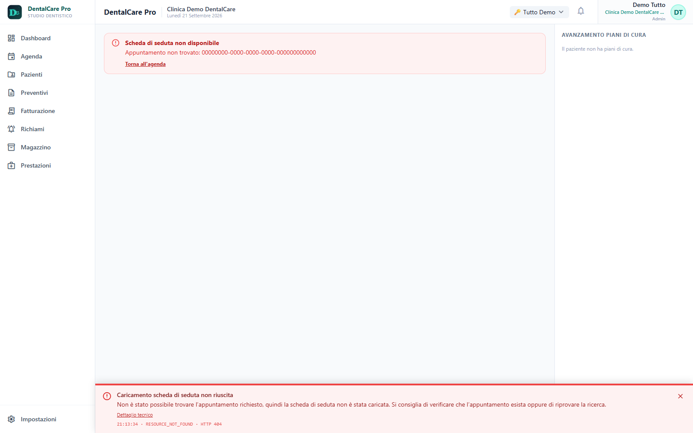

*La segnalazione di un errore: cosa, perché e cosa fare.*

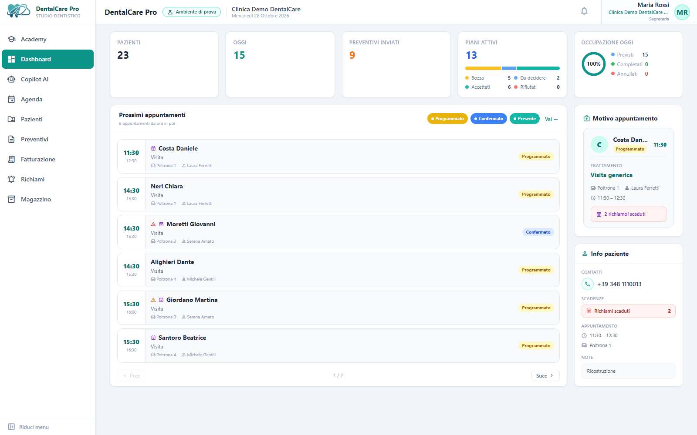

*La dashboard: indicatori, prossimi appuntamenti e scheda dell'appuntamento scelto.*

## 2. Percorsi di lavoro

*Le tappe per ruolo, dalle basi ai casi particolari: da qui si sceglie cosa studiare.*

- **[Percorso della segreteria](MANUALE_UTENTE.md#lezione-percorso-segreteria)** — Agenda, accoglienza, preventivi, incassi e richiami, giorno per giorno.
- **[Percorso del medico](MANUALE_UTENTE.md#lezione-percorso-medico)** — Dalla prima visita alla fine della cura, con le sedute e i loro casi particolari.
- **[Percorso dell'igienista](MANUALE_UTENTE.md#lezione-percorso-igienista)** — Sedute di igiene, mantenimento, richiami e collaborazione con il medico.
- **[Percorso del titolare](MANUALE_UTENTE.md#lezione-percorso-titolare)** — Avvio dell'account e delle cliniche, configurazione, controllo dell'andamento, cura dei dati.
- **[Il viaggio del paziente](MANUALE_UTENTE.md#lezione-percorso-paziente)** — Dal primo contatto al richiamo di controllo: chi fa cosa, e dove.

## 3. Pazienti

*Trovare, registrare e conoscere un paziente, anamnesi compresa.*

- **[Trovare un paziente](MANUALE_UTENTE.md#lezione-cercare-paziente)** — Ricerca, filtri e cosa dice ogni riga dell'elenco.
- **[Registrare un nuovo paziente](MANUALE_UTENTE.md#lezione-nuovo-paziente)** — I tre passi dell'anagrafica e il codice fiscale.
- **[La scheda paziente](MANUALE_UTENTE.md#lezione-scheda-paziente)** — Le schede della cartella e gli appuntamenti del paziente.
- **[L'anamnesi e le allerte](MANUALE_UTENTE.md#lezione-anamnesi)** — Compilare l'anamnesi e far comparire le allerte dove servono.

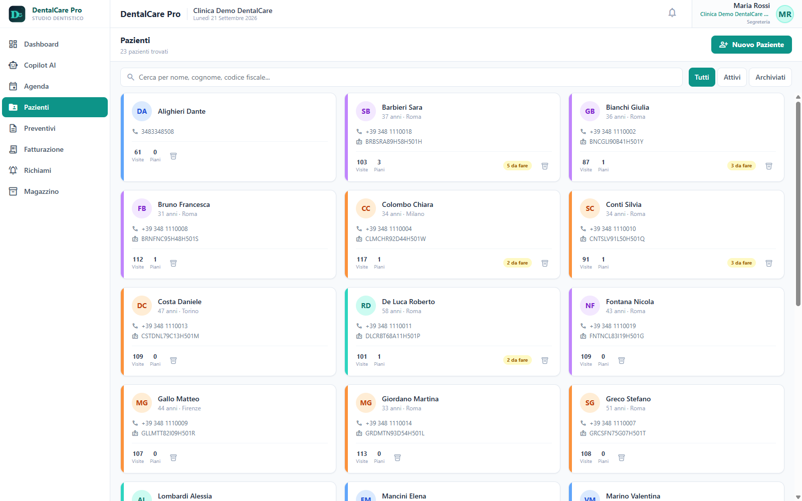

*L'elenco dei pazienti.*

## 4. Agenda e seduta

*Dalla prenotazione alla registrazione di ciò che è stato fatto in poltrona.*

- **[Le viste dell'agenda](MANUALE_UTENTE.md#lezione-viste-agenda)** — Prossimi, giorno, settimana, mese; stati, filtri e griglia degli slot.
- **[Fissare un appuntamento](MANUALE_UTENTE.md#lezione-nuovo-appuntamento)** — Orari a slot, durata, Proponi orario e prenotazione dal piano.
- **[Gestire gli appuntamenti](MANUALE_UTENTE.md#lezione-gestire-appuntamenti)** — Stati, spostamenti, cancellazioni e cosa succede al piano di cura.
- **[Dal paziente in sala alla visita in corso](MANUALE_UTENTE.md#lezione-inizia-visita)** — Presente, In corso, Inizia visita e la fotografia d'ingresso.
- **[La scheda di seduta](MANUALE_UTENTE.md#lezione-scheda-seduta)** — Registrare gli esiti e chiudere la seduta.

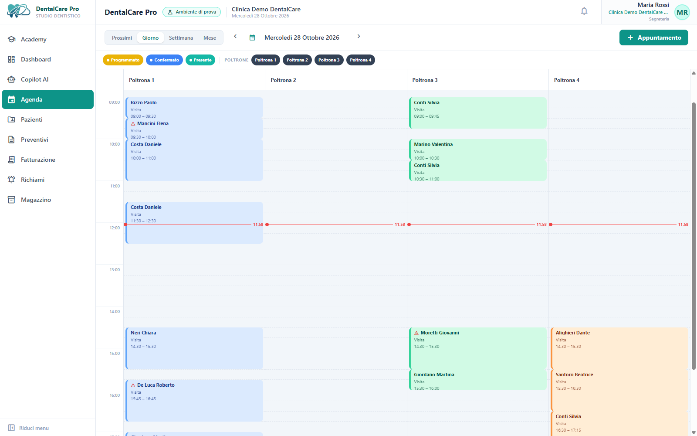

*La vista Giorno: una colonna per poltrona, i pulsanti per scegliere le poltrone mostrate, una riga tratteggiata per ogni slot.*

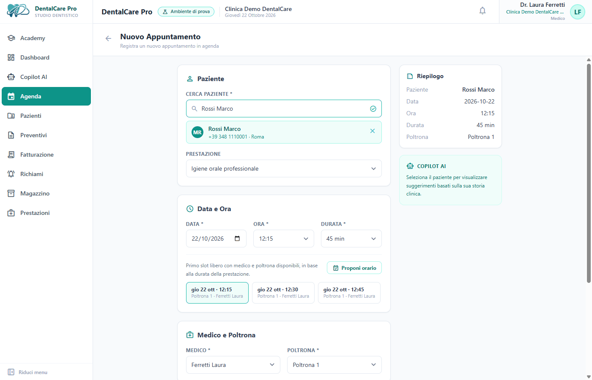

*Un nuovo appuntamento: orari a passi di slot e primi orari liberi proposti.*

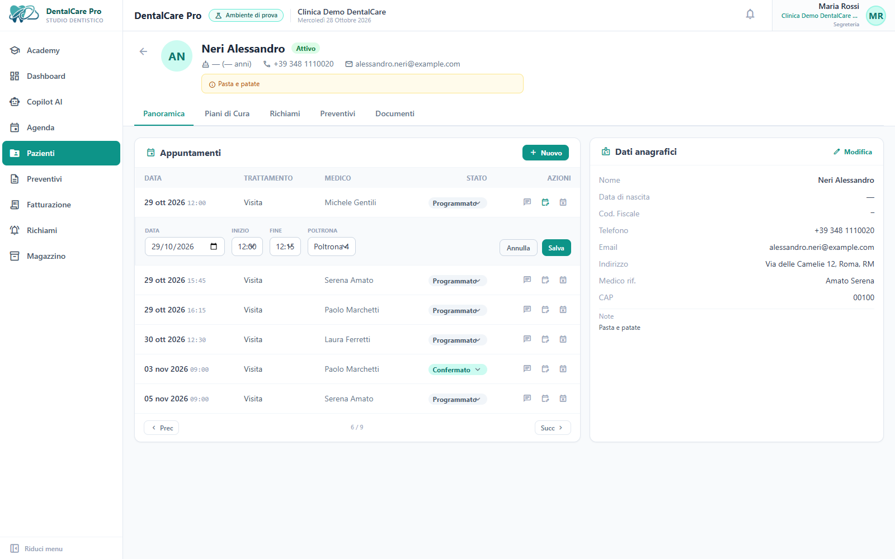

*La modifica di un appuntamento dalla scheda del paziente.*

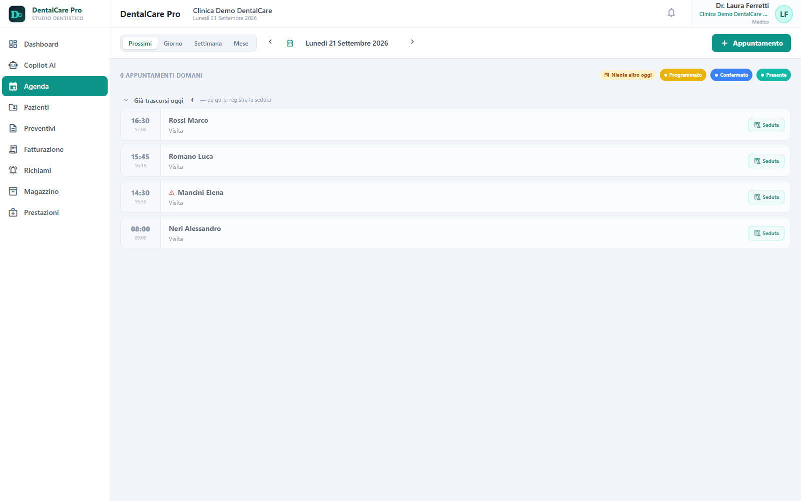

*La vista Prossimi con gli appuntamenti già trascorsi oggi.*

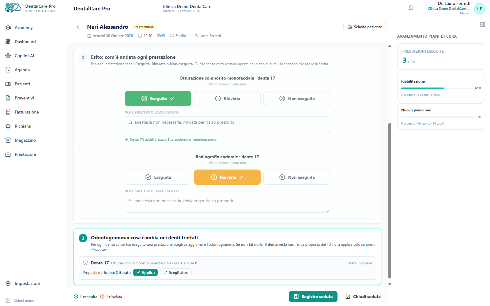

*Gli esiti di una seduta prima della registrazione.*

## 5. Sedute: casi particolari

*Quando le cose non vanno come previsto: assenze, rinvii, spostamenti, dimenticanze, vincoli.*

- **[Paziente non presentato](MANUALE_UTENTE.md#lezione-paziente-non-presentato)** — Registrare l'assenza e decidere cosa fare delle prestazioni previste.
- **[Prestazione rinviata o non eseguita](MANUALE_UTENTE.md#lezione-prestazione-rinviata)** — I tre esiti, le prestazioni in sospeso e quando togliere dal piano.
- **[Seduta fuori programma](MANUALE_UTENTE.md#lezione-seduta-fuori-programma)** — Prestazioni non previste e la seduta di un collega.
- **[Seduta dimenticata o già chiusa](MANUALE_UTENTE.md#lezione-seduta-dimenticata)** — Ingresso tardivo, registrazione a fine giornata, seduta da riaprire.
- **[Spostare o annullare un appuntamento collegato](MANUALE_UTENTE.md#lezione-spostare-appuntamento-collegato)** — Cosa succede alle prestazioni del piano, e perché il medico non si cambia.
- **[I vincoli dell'agenda](MANUALE_UTENTE.md#lezione-vincoli-agenda)** — Festivi, orari, griglia degli slot, conflitti, pazienti a rischio infettivo.

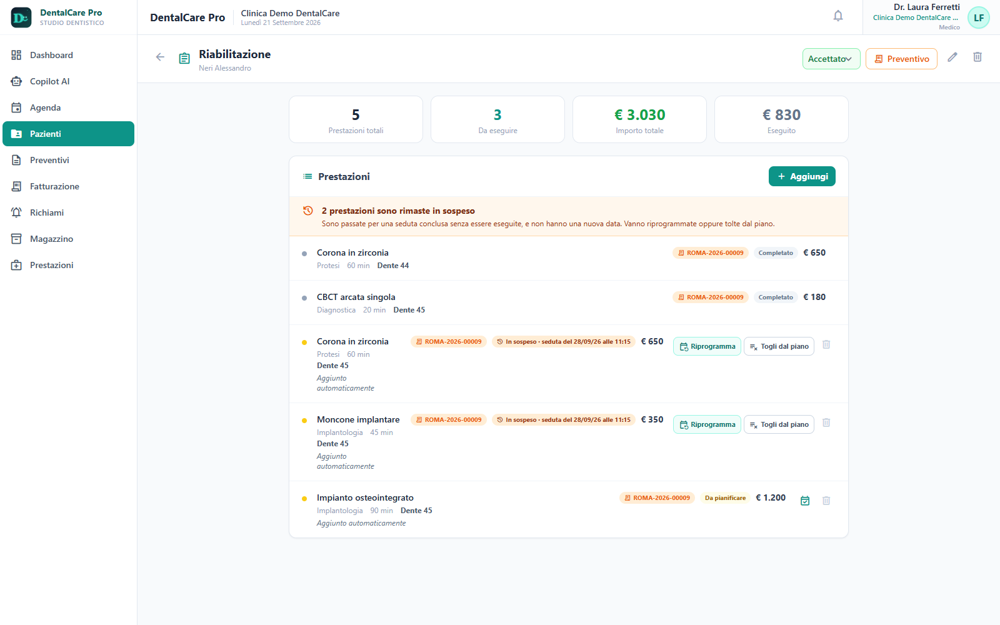

*Un piano con prestazioni in sospeso.*

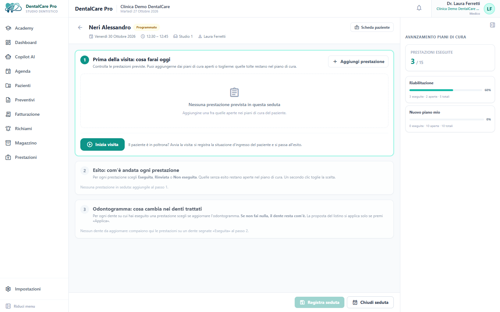

*Una seduta senza prestazioni previste: si aggiungono dal piano.*

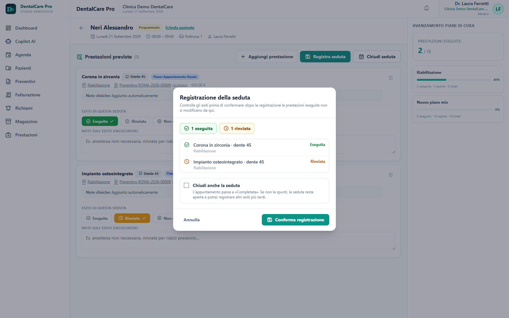

*Il riepilogo prima di registrare la seduta.*

## 6. Clinica

*Odontogramma, piani di cura, storico degli episodi, documenti e analisi AI.*

- **[L'odontogramma](MANUALE_UTENTE.md#lezione-odontogramma)** — Superfici, condizioni del dente e legenda.
- **[Dal dente al piano: «Genera piano di cura»](MANUALE_UTENTE.md#lezione-genera-piano)** — Cosa viene proposto, cosa no e perché.
- **[Il piano di cura](MANUALE_UTENTE.md#lezione-piano-di-cura)** — Stati, prestazioni, Pianifica appuntamento e prestazioni in sospeso.
- **[Lo storico degli episodi](MANUALE_UTENTE.md#lezione-storico-episodi)** — Com'era il paziente prima di una visita, e cosa è cambiato.
- **[Diagnosi, prescrizioni e documenti](MANUALE_UTENTE.md#lezione-diagnosi-prescrizioni-documenti)** — Il diario clinico, le terapie in corso e i documenti del paziente.
- **[Analisi AI delle radiografie](MANUALE_UTENTE.md#lezione-analisi-ai-radiografie)** — Lanciare l'analisi di un'ortopanoramica e rivederla da medico.

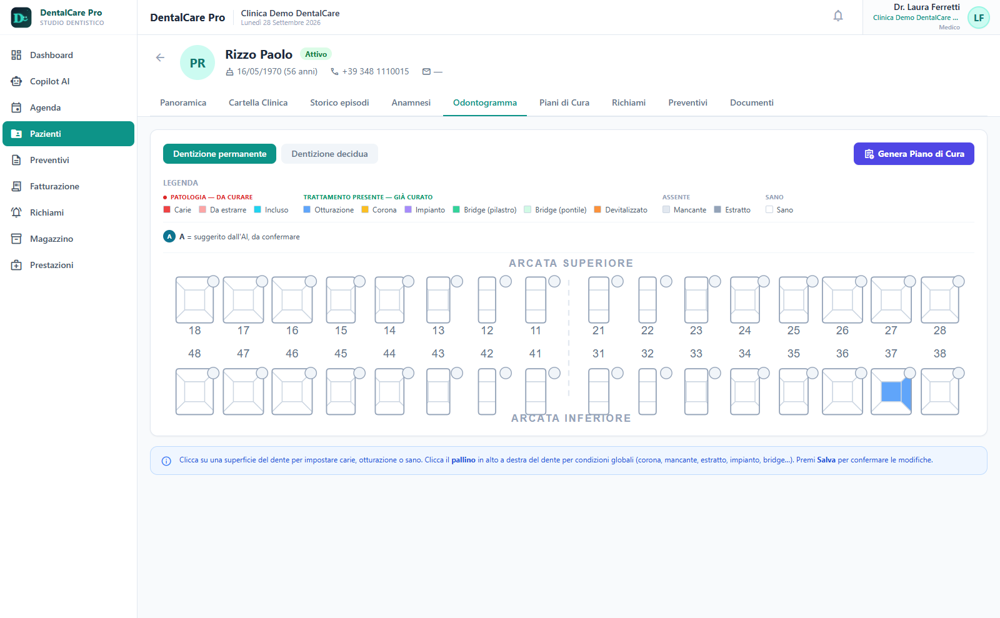

*L'odontogramma con la legenda: da curare, già curato, assente.*

*Un piano con prestazioni in sospeso.*

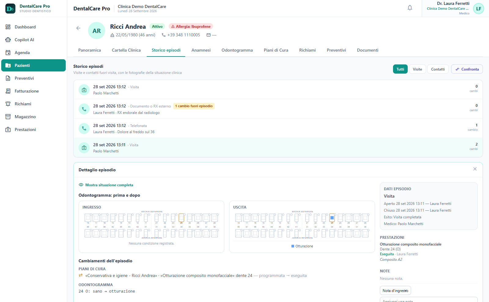

*Un episodio: odontogramma prima e dopo, cambiamenti e riepilogo.*

## 7. Amministrazione

*Preventivi, fatture, richiami, magazzino, listino e tariffe.*

- **[Preventivi e avanzamento](MANUALE_UTENTE.md#lezione-preventivi)** — Dal piano al preventivo, stati e lavoro fatturabile.
- **[Fatture, acconti e storni](MANUALE_UTENTE.md#lezione-fatturazione)** — Saldo e acconto, vita di un documento, note di credito, intestazione.
- **[I richiami](MANUALE_UTENTE.md#lezione-richiami)** — Chi ricontattare e quando; registrare i contatti.
- **[Il magazzino](MANUALE_UTENTE.md#lezione-magazzino)** — Prodotti, soglie, movimenti e fornitori.
- **[Prestazioni e listino](MANUALE_UTENTE.md#lezione-prestazioni-listino)** — Prezzi, durate, denti ammessi, effetto sul dente e default per condizione.
- **[Le tariffe del medico](MANUALE_UTENTE.md#lezione-tariffe-medico)** — Prezzi personali diversi dal listino, quando si fattura a nome del medico.

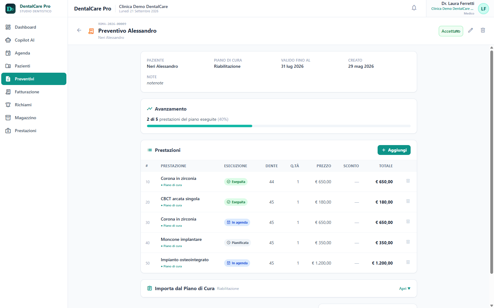

*L'avanzamento delle prestazioni di un preventivo.*

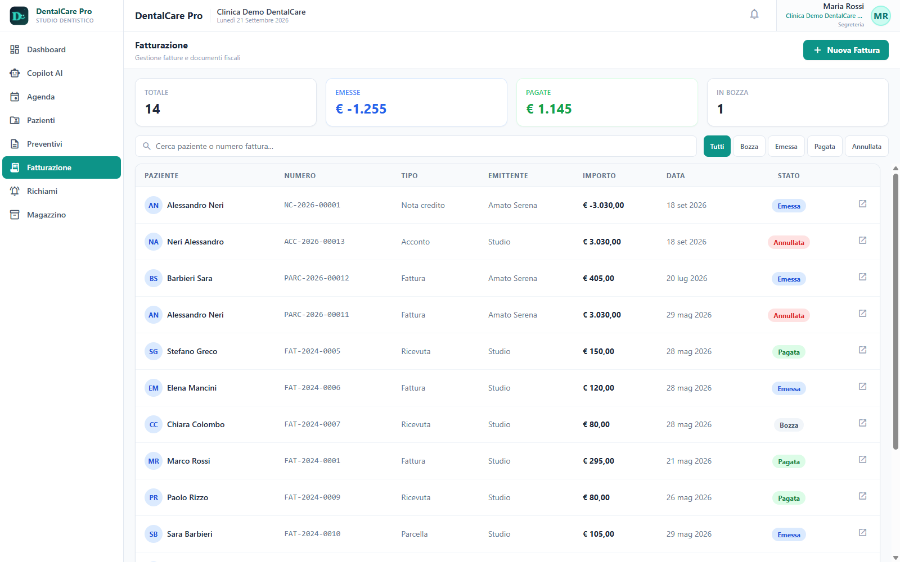

*L'elenco dei documenti fiscali.*

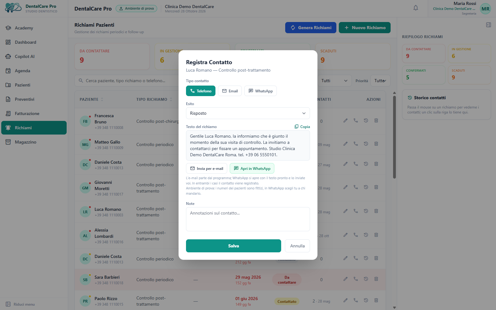

*Registra contatto: il testo del richiamo, da copiare o da inviare per e-mail o WhatsApp.*

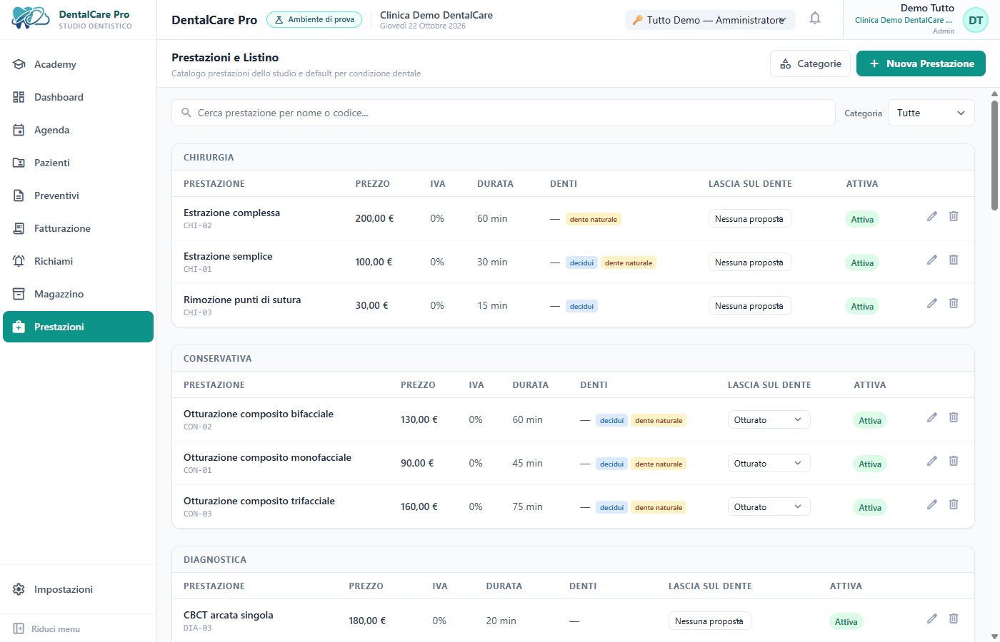

*Il listino, con categorie, prezzi, durate e default per condizione.*

## 8. Copilot AI

*L'assistente che legge i dati dello studio: modalità, domande, conferme e limiti.*

- **[Chiedere al Copilot](MANUALE_UTENTE.md#lezione-copilot)** — Modalità amministrativa e clinica, domande, anteprime e suggerimenti.
- **[Copilot clinico](MANUALE_UTENTE.md#lezione-copilot-clinico)** — Interrogare la cartella in linguaggio naturale, da medico.
- **[Cosa fa il Copilot e cosa no](MANUALE_UTENTE.md#lezione-copilot-limiti)** — Limiti, conferme e riservatezza delle conversazioni.

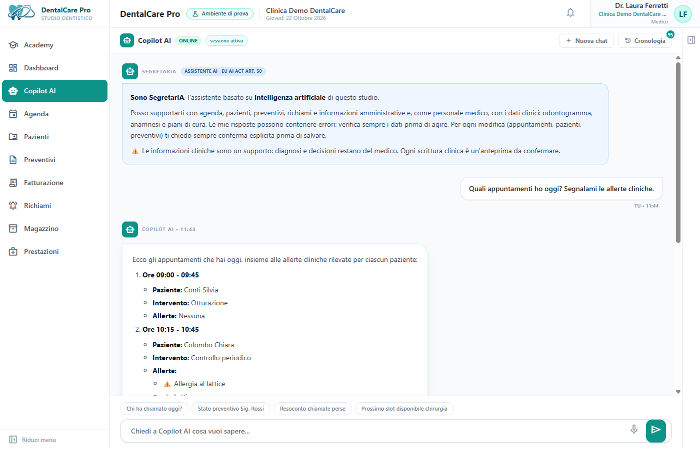

*Il Copilot clinico: appuntamenti di oggi con le allerte di ogni paziente.*

## 9. Impostazioni della clinica

*Per il titolare e l'amministratore: dati, persone, agenda, documenti, Copilot.*

- **[Clinica e professionisti](MANUALE_UTENTE.md#lezione-impostazioni-studio)** — Dati della clinica, modalità di fatturazione, professionisti, poltrone e catalogo dell'anamnesi.
- **[Agenda e visibilità](MANUALE_UTENTE.md#lezione-impostazioni-agenda)** — Slot, orario e giorni di lavoro, chi vede quali pazienti.
- **[Calendario delle presenze](MANUALE_UTENTE.md#lezione-calendario-presenze)** — Orario di ogni professionista, assenze e appuntamenti da spostare.
- **[Preventivi, fatture, richiami e sistema](MANUALE_UTENTE.md#lezione-impostazioni-documenti)** — Valori predefiniti dei documenti, intervalli dei richiami, preferenze.
- **[Copilot e AI](MANUALE_UTENTE.md#lezione-impostazioni-ai)** — Modo del Copilot (spento, amministrativo, clinico) e istruzioni.
- **[Ambiente di prova e amministrazione dell'account](MANUALE_UTENTE.md#lezione-ambiente-prova-studio)** — Esercitarsi senza toccare i dati veri; sedi, esportazione, chiusura.

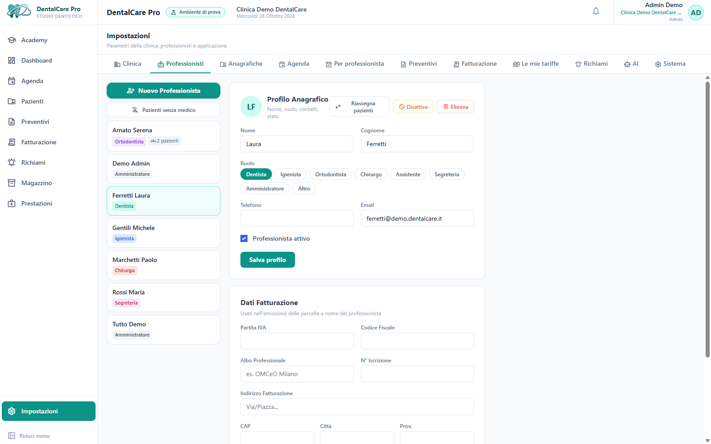

*Un professionista: profilo, ruolo, dati di fatturazione e azioni.*

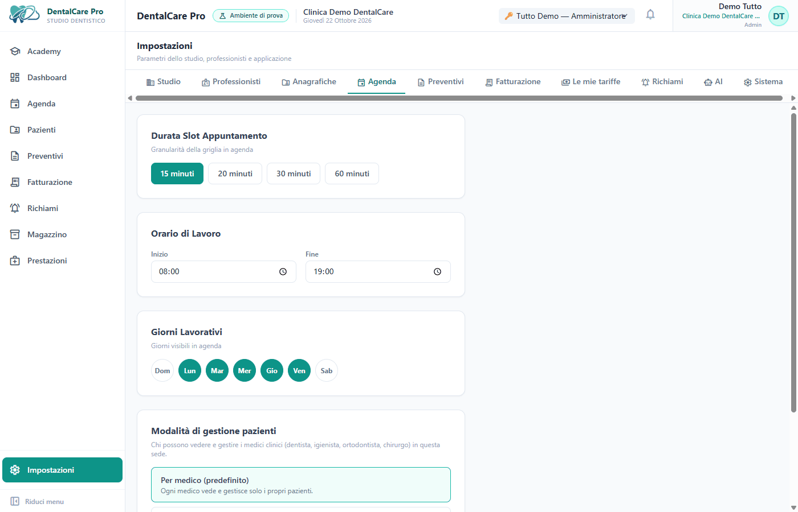

*Durata dello slot, orario di lavoro, giorni lavorativi.*

## 10. Riferimento

*Le parole del programma, con il loro significato preciso.*

- **[Glossario](MANUALE_UTENTE.md#lezione-glossario)** — I termini del manuale, in ordine alfabetico.
